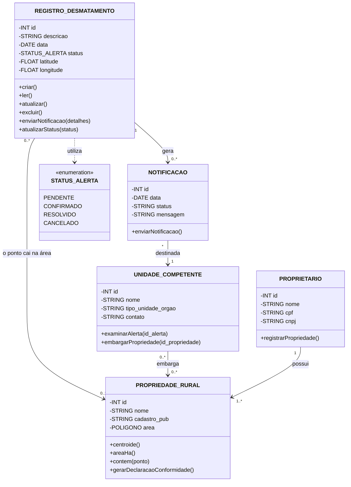
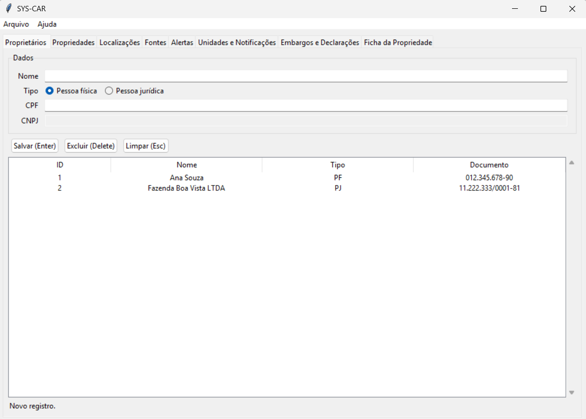
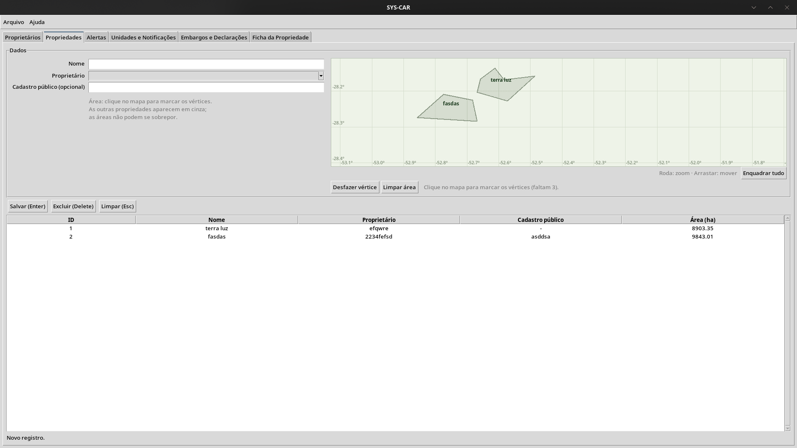
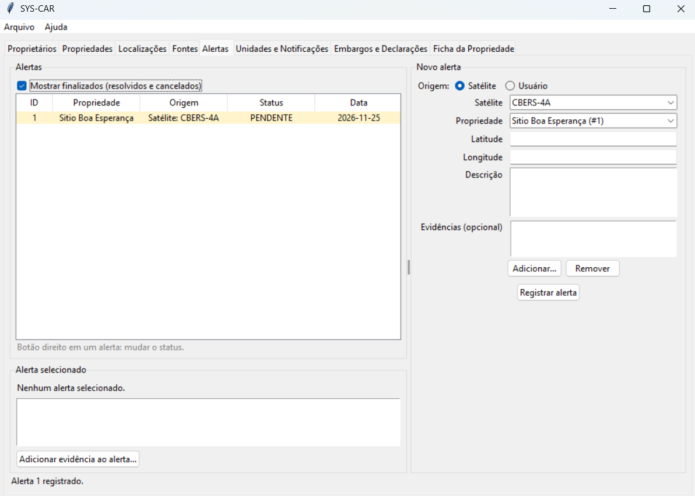
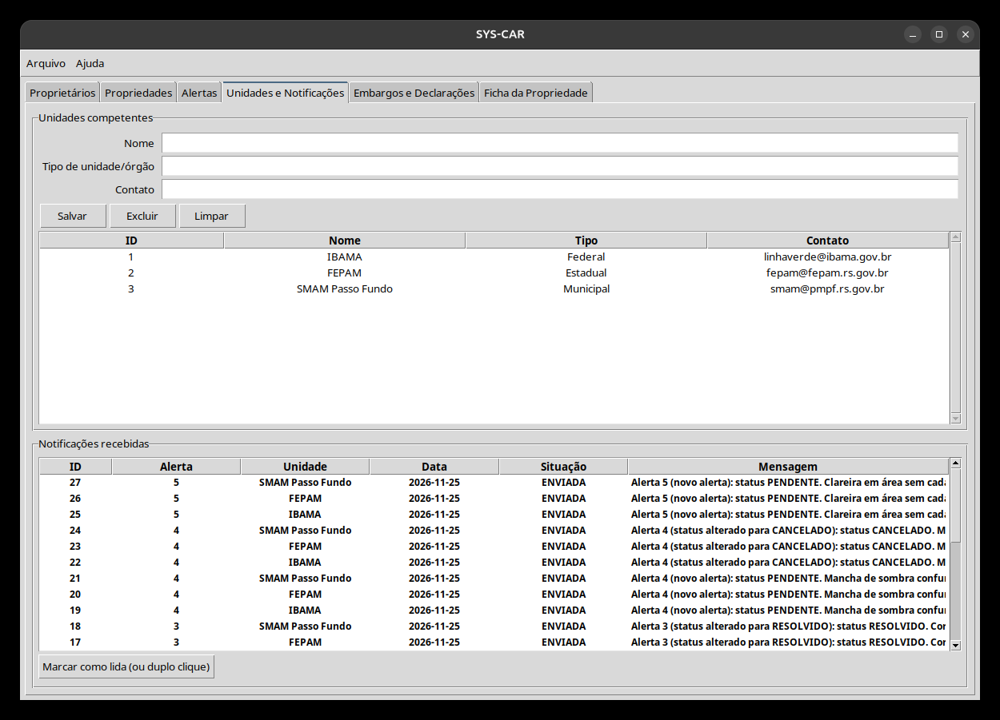
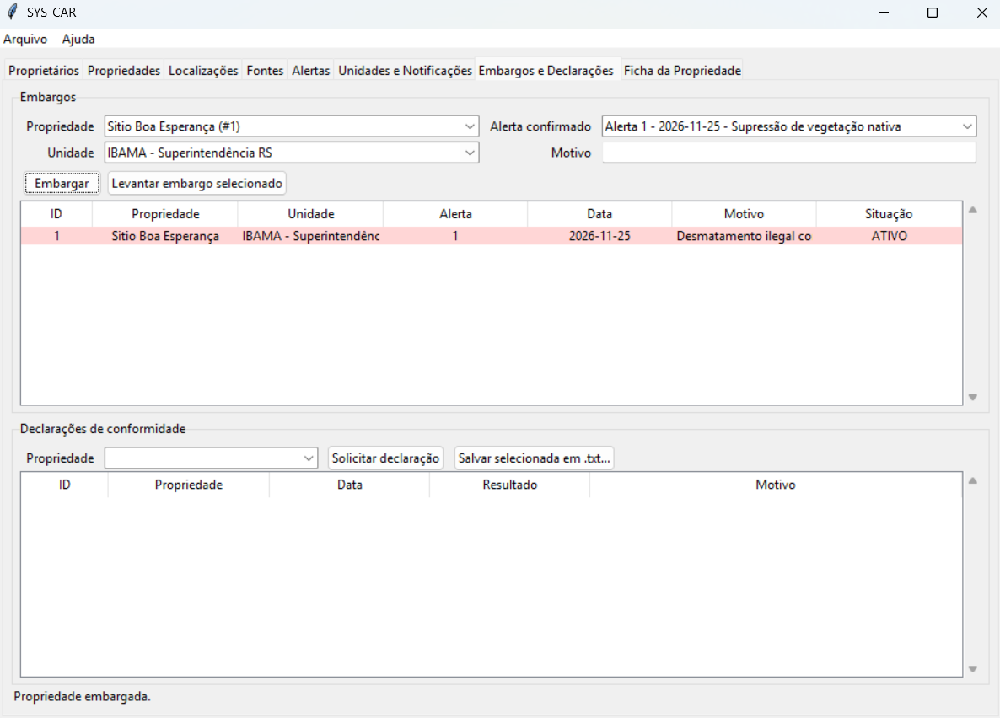
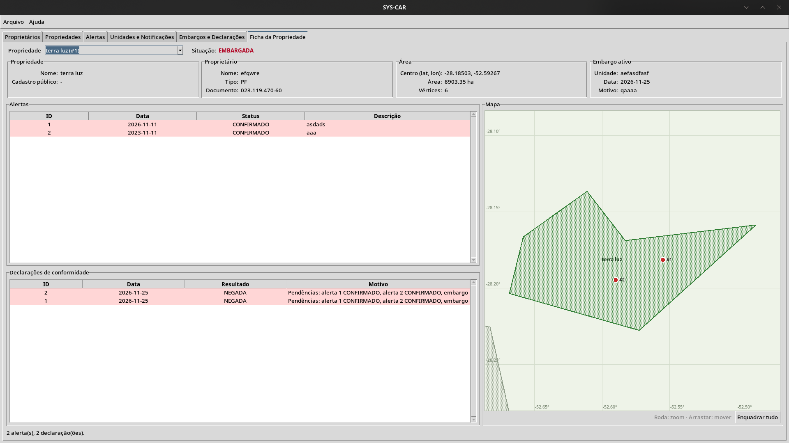

# Sistema de Cadastro Ambiental Rural (sys-car)

## Detalhes

- Instituição:
  - Instituto Federal Sul-Riograndense de Passo Fundo
- Disciplina:
  - Linguagem de Programação Orientada a Objetos - 4° Semestre
- Docente:
  - Leonardo Deliyannis Constantin

## Descrição

- Proprietários poderão registrar suas propriedades rurais, declarando as coordenadas e o polígono que delimita cada propriedade.
- Poderão requisitar declarações de conformidade ambiental, onde será buscado em uma base de alertas de desmatamento se há algum alerta, se não houver, será emitido.
- As propriedades registradas poderão ser embargadas por autoridades competentes se for comprovado desmatamento ilegal

## Funcionalidades

| Área | O que o sistema faz |
|---|---|
| Proprietários | Cadastra pessoa física (CPF) e jurídica (CNPJ, inclusive alfanumérico), com validação do dígito verificador |
| Propriedades | Cadastra a propriedade com a área desenhada no mapa. Calcula o centro e a área em hectares. Duas áreas não se sobrepõem |
| Alertas | Registra o desmatamento com um clique no mapa. A propriedade é a que contém o ponto. Edita a descrição e a data e exclui o alerta. O status segue as regras do padrão State |
| Unidades e notificações | Cadastra os órgãos competentes. Cada alerta novo ou mudança de status gera uma notificação para cada órgão |
| Embargos | Embarga uma propriedade a partir de um alerta confirmado. Levanta o embargo e altera o motivo |
| Declarações | Emite ou nega a declaração de conformidade ambiental e salva o texto em `.txt` |
| Ficha da propriedade | Mostra numa tela só o proprietário, a área, os alertas, o embargo ativo, as declarações e a situação da propriedade |

## Integrantes:

- Pedro Henrique Carteli Rossetto
  - Desenvolvedor
  - @pedrohrossetto
- Matheus Pastore Polese
  - Desenvolvedor
  - @MatheusPolese
- Victor Hugo Andreon
  - Desenvolvedor
  - @VictorAndreon
- Eduardo Milani
  - Desenvolvedor
  - @EduardoMilani8

## Diagrama do Modelo Conceitual



O diagrama acima é o modelo **conceitual**. A propriedade tem uma área (polígono) que não se sobrepõe à de outra
propriedade; o alerta é um ponto no mapa e pertence à propriedade cuja área contém o ponto (ou a nenhuma).
 Os diagramas da implementação ficam em [`docs/`](docs/README.md).

## Interface

A janela principal tem uma aba para cada cadastro. As abas Propriedades, Alertas e Ficha da Propriedade têm um
mapa: a área da propriedade é desenhada clique a clique, e o alerta é um clique no lugar do desmatamento
(roda do mouse: zoom; arrastar: mover).













## Documentação

Toda a documentação técnica (decisões de projeto, diagramas UML em pt-BR e EN e guias em Leitura Fácil) está em [`docs/README.md`](docs/README.md).

## Estrutura do Projeto

O projeto segue o padrão **MVC (Model-View-Controller)** com banco de dados **SQLite** e interface **Tkinter**.

```
sys-car/
├── README.md
├── docs/                         # documentação (ADRs, UML, guias)
├── data/                         # (criada automaticamente) banco SQLite
│   └── syscar.db
├── tests/                        # testes automatizados (unittest)
└── src/
    ├── main.py                   # ponto de entrada
    ├── descoberta.py             # descoberta automática de tabelas e abas
    ├── database/
    │   └── database.py           # conexão + init_db() (executa o SCHEMA de cada model)
    ├── model/                    # classes de domínio; cada uma declara seu SCHEMA
    │   ├── base.py               # ModeloBase (Template Method)
    │   ├── documento.py          # validadores de CPF/CNPJ (Strategy)
    │   ├── coordenadas.py        # validação de latitude, longitude e texto do polígono
    │   ├── geometria.py          # Poligono: centroide, área, ponto dentro, sobreposição
    │   ├── proprietario.py
    │   ├── propriedade_rural.py  # com a área (polígono) da propriedade
    │   └── fiscalizacao/         # alertas, notificações, embargos, declarações
    ├── controller/               # regras de negócio e validações
    └── view/
        ├── janela_principal.py   # janela, menu e descoberta das abas
        ├── aba_crud.py           # AbaCrud (Template Method)
        ├── widgets.py            # Seletor e tabela com rolagem
        ├── projecao.py           # lat/lon <-> pixels do mapa (sem tkinter)
        ├── mapa.py               # MapaCanvas e EditorArea (mapa em Canvas)
        └── *_aba.py              # uma aba por entidade
```

### Padrões de projeto e arquitetura

| Padrão | Onde está | Decisão |
|---|---|---|
| MVC com contrato de plugin | `src/model`, `src/controller`, `src/view`, `src/descoberta.py` | [ADR-001](docs/decisoes/ADR-001-arquitetura-mvc-plugins.pt-br.md) |
| Template Method | `ModeloBase` (`model/base.py`) e `AbaCrud` (`view/aba_crud.py`) | [ADR-C01](docs/cadastro/ADR-C01-template-method-modelo-base.pt-br.md), [ADR-C04](docs/cadastro/ADR-C04-aba-crud-template-method.pt-br.md) |
| Strategy | Validadores de CPF e CNPJ (`model/documento.py`) | [ADR-C02](docs/cadastro/ADR-C02-strategy-validacao-documento.pt-br.md) |
| State | Status do alerta (`model/fiscalizacao/status.py`) | [ADR-F01](docs/fiscalizacao/ADR-F01-state-status-alerta.pt-br.md) |
| Observer | Notificações das unidades (`model/fiscalizacao/observador.py`) | [ADR-F02](docs/fiscalizacao/ADR-F02-observer-notificacoes.pt-br.md) |
| Singleton | `PublicadorAlertas.instancia()` (`model/fiscalizacao/observador.py`) | [ADR-F08](docs/fiscalizacao/ADR-F08-singleton-publicador-alertas.pt-br.md) |
| Factory Method | Criação da declaração (`model/fiscalizacao/resultado_analise.py`) | [ADR-F11](docs/fiscalizacao/ADR-F11-remocao-das-fontes-e-factory-na-declaracao.pt-br.md) |

Todos os models acessam o banco pelo `ModeloBase` ([ADR-F09](docs/fiscalizacao/ADR-F09-acesso-a-dados-unificado.pt-br.md)).
O tratamento de exceções segue o MVC: o model lança, o controller captura e a view mostra ([ADR-003](docs/decisoes/ADR-003-estrategia-de-excecoes.pt-br.md)).
A relação entre o trabalho e o plano de ensino está em [`docs/status-do-trabalho.md`](docs/status-do-trabalho.md).

### Executar

```bash
python3 src/main.py
```

O programa precisa do **Tkinter**:

- Linux (Debian/Ubuntu): `sudo apt install python3-tk`
- Windows e macOS: o instalador oficial do Python (python.org) já inclui o Tkinter.

Na primeira execução, o programa cria a pasta `data/` e o banco `data/syscar.db`.

> **Banco de uma versão antiga:** se o programa avisar que o banco é de uma versão antiga, apague o arquivo `data/syscar.db` e rode de novo.

### Testes

```bash
python3 -m unittest discover -s tests -v
```

São 186 testes automatizados. Os testes não usam o Tkinter e criam um banco temporário: o `data/syscar.db` não muda.

### Como adicionar uma entidade nova

Nenhum arquivo central precisa ser editado:

1. **model/**: crie a classe e declare a constante `SCHEMA` com o `CREATE TABLE IF NOT EXISTS`. O `init_db()` encontra sozinho.
2. **controller/**: crie o controller com as regras. Os métodos de escrita devolvem `(resultado, erro)`.
3. **view/**: crie o módulo da aba com `ORDEM` e `registrar_abas(notebook)`. A janela principal encontra sozinha.
4. **tests/**: crie os testes da entidade.

O acompanhamento do que falta fazer fica nas issues do GitHub.
