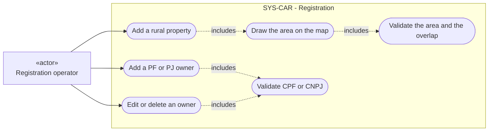
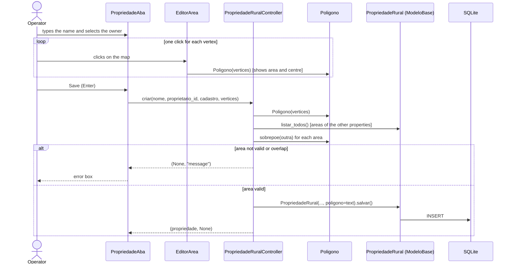
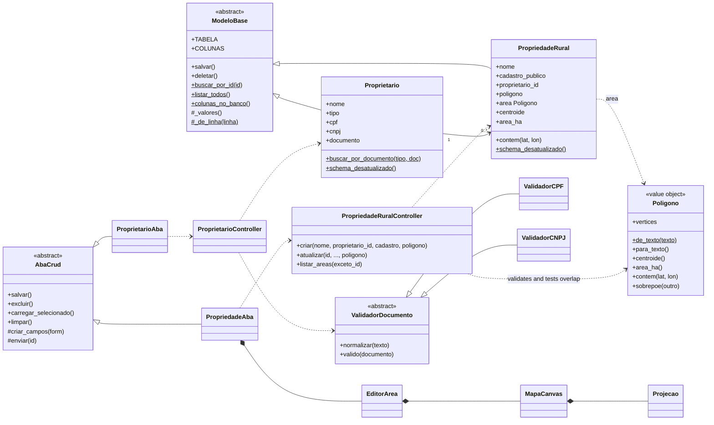
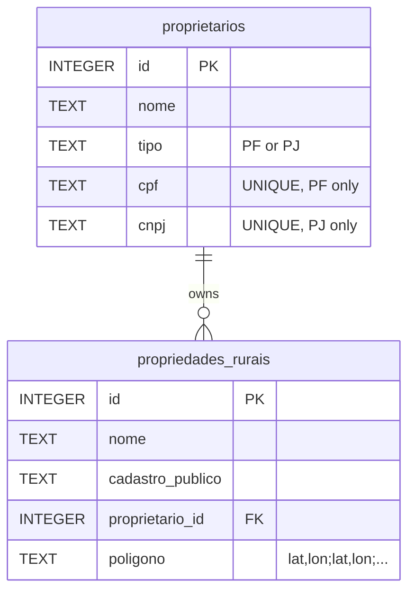

# Registration UML diagrams

## Use cases

Mermaid does not have a native use case diagram. This diagram uses a `flowchart`.
The rectangle is the actor. The round shapes are the use cases.

## Sequence: add a property with its area

## Implementation classes

`ModeloBase` and `AbaCrud` are the Template Method points. `ValidadorDocumento` is the Strategy.
`Poligono` is a value object: it has no table (ADR-C05). `MapaCanvas` and `Projecao` are in [ADR-002](../decisoes/ADR-002-mapa-em-canvas.en.md).

## Data model

When you delete an owner, the system also deletes the properties (`ON DELETE CASCADE`).
The column `poligono` accepts NULL in the database, but the controller requires the area.

