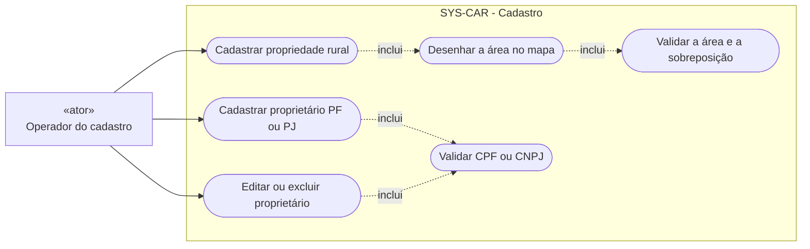
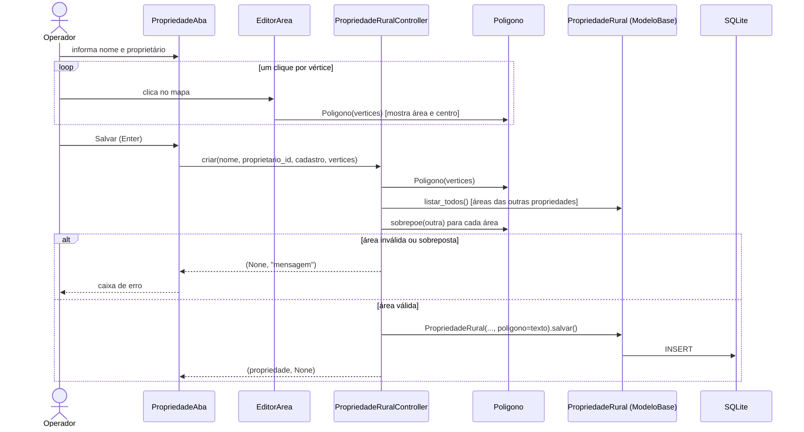
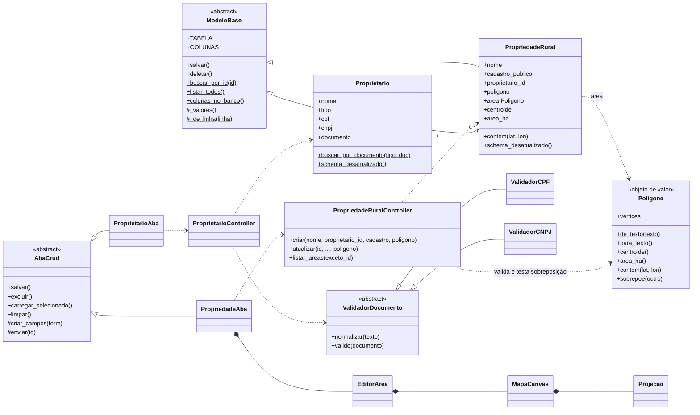
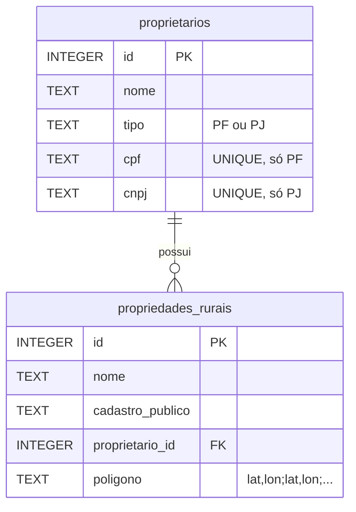

# Diagramas UML do Cadastro

## Casos de uso

O Mermaid não tem diagrama de caso de uso nativo. Este diagrama usa um `flowchart`:
o retângulo é o ator e as formas arredondadas são os casos de uso.

## Sequência: cadastrar propriedade com a área

## Classes da implementação

`ModeloBase` e `AbaCrud` são os pontos de Template Method. `ValidadorDocumento` é a Strategy.
`Poligono` é um objeto de valor: não tem tabela (ADR-C05). `MapaCanvas` e `Projecao` estão na [ADR-002](../decisoes/ADR-002-mapa-em-canvas.pt-br.md).

## Modelo de dados

Apagar um proprietário apaga as propriedades dele (`ON DELETE CASCADE`).
A coluna `poligono` aceita NULL no banco, mas o controller exige a área.

