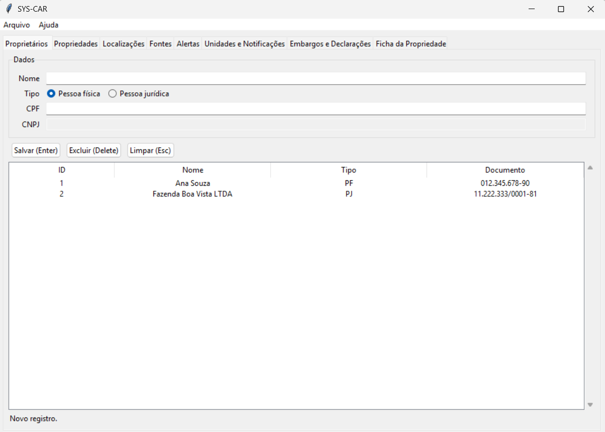
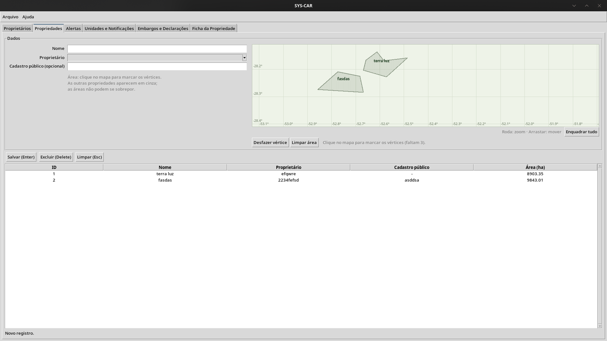

# Como usar o Cadastro do SYS-CAR

Este guia usa frases curtas.
Cada passo tem uma ação.

## O que é o Cadastro

O Cadastro guarda 2 coisas:

- o **proprietário**: a pessoa ou a empresa dona da terra;
- a **propriedade**: a terra, por exemplo um sítio ou uma fazenda.

Toda propriedade tem uma **área**: a borda da terra, desenhada no mapa.

## Antes de começar

1. Abra o programa.
2. Veja as abas no alto da janela.
3. Clique na aba que você quer usar.

## Cadastrar um proprietário

1. Clique na aba **Proprietários**.
2. Escreva o nome.
3. Escolha **Pessoa física** ou **Pessoa jurídica**.
4. Pessoa física: escreva o CPF.
5. Pessoa jurídica: escreva o CNPJ.
6. Aperte **Enter** ou clique em **Salvar**.
7. O proprietário aparece na lista.

Se aparecer uma caixa de erro, leia a mensagem.
A mensagem diz o que está errado.
Corrija e salve de novo.

## Cadastrar uma propriedade

1. Clique na aba **Propriedades**.
2. Escreva o nome da propriedade.
3. Escolha o proprietário na lista.
4. Desenhe a área no mapa (veja abaixo).
5. Aperte **Enter** ou clique em **Salvar**.

## Desenhar a área no mapa

1. Clique no mapa num canto da terra.
2. Clique no próximo canto. Siga a borda da terra.
3. Use 3 cantos ou mais.
4. Embaixo do mapa aparecem o tamanho da área e o centro.
5. Errou o último canto? Clique em **Desfazer vértice**.
6. Quer começar de novo? Clique em **Limpar área**.

Para mexer no mapa:

- gire a **roda do mouse** para aproximar ou afastar;
- **arraste** o mapa para mudar o lugar;
- clique em **Enquadrar tudo** para ver todas as áreas.

As outras propriedades aparecem em cinza.
Uma área não pode entrar na área de outra propriedade.
As áreas podem encostar uma na outra.

## Mudar um cadastro

1. Clique 2 vezes na linha da lista.
2. Os dados vão para o formulário.
3. Mude o que precisa.
4. Aperte **Enter**.

## Apagar um cadastro

1. Clique 1 vez na linha da lista.
2. Aperte a tecla **Delete** ou clique em **Excluir**.
3. Confirme.

Cuidado: apagar um proprietário apaga as propriedades dele.
Os alertas dessas propriedades ficam no mapa, sem propriedade.

## Limpar o formulário

Aperte **Esc** ou clique em **Limpar**.
