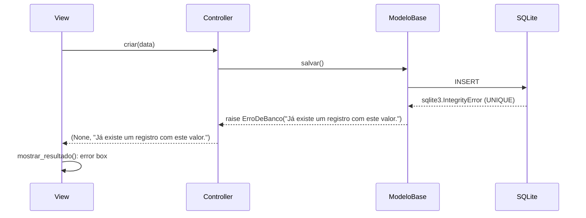

# ADR-003: Exception handling strategy

**Status:** accepted

## Context

The teaching plan asks for exception handling:

- the syllabus and Unit 1.4 include exception handling;
- a specific objective asks for "mecanismos de tratamento de exceções para garantir robustez e confiabilidade das aplicações" (exception handling mechanisms for robust and reliable applications).

The system already handled the validation errors. The model raised `ValueError`, and the controller returned `(None, "message")`.
But there were three problems:

1. The system did not handle a database error (`sqlite3.Error`). The error went to the view as an exception, and the action stopped without a message.
2. An unexpected error in a click showed only in the terminal. The user did not see it.
3. The system did not handle an error when it wrote the `.txt` file of the declaration (no permission on the folder, full disk).

## Decision

Each MVC layer has one fixed task:

| Layer | Task | Location |
|---|---|---|
| Model | **Raises** the exception | `ValueError` in the validations, `TransicaoInvalida` in the State pattern, `ErroDeBanco` in `ModeloBase` |
| Controller | **Catches** the exception and returns `(None, "message")` | `try/except` in the validations and the decorator `@devolve_erro` |
| View | **Shows** the message | `mostrar_resultado()` and the last defense of the main window |

### Exceptions of the system

| Exception | Inherits from | When it occurs |
|---|---|---|
| `TransicaoInvalida` | `ValueError` | A status change that the State pattern does not permit (see [ADR-F01](../fiscalizacao/ADR-F01-state-status-alerta.en.md)) |
| `ErroDeBanco` | `Exception` | All SQLite errors |

### Database errors in one location

- `ModeloBase` opens all the connections through the context manager `_conexao()`.
- `_conexao()` catches `sqlite3.Error` and raises `ErroDeBanco` with a message in Portuguese:

  | SQLite error | Message (Portuguese) | Meaning |
  |---|---|---|
  | `UNIQUE` | Já existe um registro com este valor. | A record with this value already exists. |
  | `FOREIGN KEY` | O registro está ligado a outro registro que não existe ou que ainda o usa. | The record is connected to a record that does not exist, or that still uses it. |
  | `CHECK` | Um dos valores não é aceito pelo banco de dados. | The database does not accept one of the values. |
  | `NOT NULL` | Um campo obrigatório ficou vazio. | A mandatory field is empty. |
  | Other error | Não foi possível acessar o banco de dados (detail). | The system cannot access the database (detail). |

- `ErroDeBanco` keeps the original exception in `__cause__` (`raise ... from erro`).
- The controller and the view do not import `sqlite3`. They know only `ErroDeBanco`.
- Without `commit`, SQLite cancels the operation that failed. `salvar()` puts the `id` in the object only after the `commit`.

### Controller

The decorator `@devolve_erro` (`controller/erros.py`) catches `ErroDeBanco` and returns `(None, "message")`.
Rule: each controller method that returns `(resultado, erro)` uses the decorator. A test checks this rule.

The decorator catches **only** `ErroDeBanco`. A programming defect (for example, `TypeError`) stays visible.

### View

- The main window sets `root.report_callback_exception`. An unhandled error in an event shows the box "Erro inesperado" (unexpected error). It also writes the full traceback in the terminal.
- The "Embargos e Declarações" tab catches `OSError` when it writes the `.txt` file, and shows the message.

## Consequences

- A database error shows on the screen as all the other errors do. The program does not stop.
- The code that opens and closes the connection is in one location. `ModeloBase` is shorter.
- An unexpected error is not lost in the terminal.
- The tests cause real SQLite errors. The tests do not simulate errors.

## Location in the code

- `src/model/erros.py`: `ErroDeBanco`
- `src/model/base.py`: `_conexao()`
- `src/model/fiscalizacao/status.py`: `TransicaoInvalida`
- `src/controller/erros.py`: `@devolve_erro`
- `src/view/janela_principal.py`: `_erro_inesperado()`
- `src/view/fiscalizacao/conformidade_aba.py`: writing of the `.txt` file
- `tests/test_excecoes.py`
