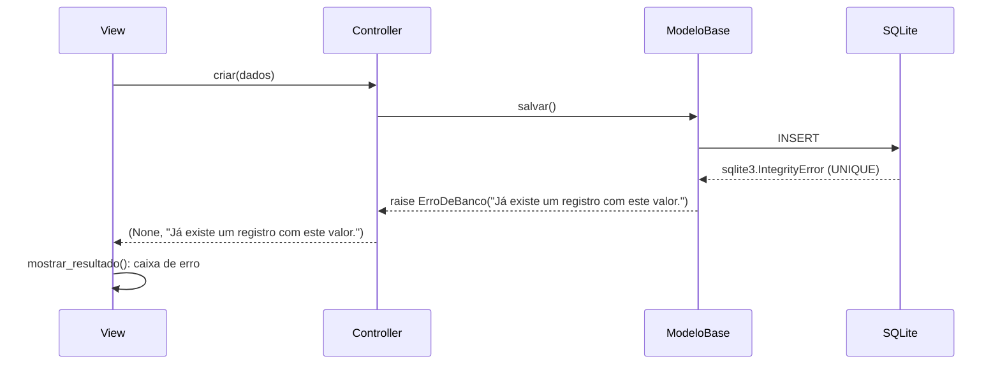

# ADR-003: Estratégia de tratamento de exceções

**Status:** aceita

## Contexto

O plano de ensino pede tratamento de exceções:

- a ementa e a Unidade 1.4 citam o tratamento de exceções;
- um objetivo específico pede "mecanismos de tratamento de exceções para garantir robustez e confiabilidade das aplicações".

O sistema já tratava os erros de validação. O model lançava `ValueError`, e o controller devolvia `(None, "mensagem")`.
Mas havia três falhas:

1. Um erro do banco (`sqlite3.Error`) não era tratado. Ele chegava à view como exceção e a ação parava sem mensagem.
2. Um erro inesperado num clique aparecia só no terminal. O usuário não via nada.
3. Um erro ao gravar o arquivo `.txt` da declaração (pasta sem permissão, disco cheio) também não era tratado.

## Decisão

Cada camada do MVC tem uma tarefa fixa:

| Camada | Tarefa | Onde está |
|---|---|---|
| Model | **Lança** a exceção | `ValueError` nas validações, `TransicaoInvalida` no State, `ErroDeBanco` no `ModeloBase` |
| Controller | **Captura** a exceção e devolve `(None, "mensagem")` | `try/except` nas validações e o decorador `@devolve_erro` |
| View | **Mostra** a mensagem | `mostrar_resultado()` e a última defesa da janela principal |

### Exceções próprias

| Exceção | Herda de | Quando acontece |
|---|---|---|
| `TransicaoInvalida` | `ValueError` | Uma mudança de status que o State não permite (ver [ADR-F01](../fiscalizacao/ADR-F01-state-status-alerta.pt-br.md)) |
| `ErroDeBanco` | `Exception` | Qualquer falha do SQLite |

### Erros do banco num ponto só

- O `ModeloBase` abre todas as conexões pelo gerenciador de contexto `_conexao()`.
- O `_conexao()` captura o `sqlite3.Error` e lança o `ErroDeBanco` com uma mensagem em português:

  | Erro do SQLite | Mensagem |
  |---|---|
  | `UNIQUE` | Já existe um registro com este valor. |
  | `FOREIGN KEY` | O registro está ligado a outro registro que não existe ou que ainda o usa. |
  | `CHECK` | Um dos valores não é aceito pelo banco de dados. |
  | `NOT NULL` | Um campo obrigatório ficou vazio. |
  | Outro erro | Não foi possível acessar o banco de dados (detalhe). |

- O `ErroDeBanco` guarda a exceção original em `__cause__` (`raise ... from erro`).
- O controller e a view não importam `sqlite3`. Eles só conhecem o `ErroDeBanco`.
- Sem `commit`, o SQLite desfaz a operação que falhou. O `salvar()` só guarda o `id` no objeto depois do `commit`.

### Controller

O decorador `@devolve_erro` (`controller/erros.py`) captura o `ErroDeBanco` e devolve `(None, "mensagem")`.
Regra: todo método de controller que devolve `(resultado, erro)` usa o decorador. Um teste verifica essa regra.

O decorador captura **só** o `ErroDeBanco`. Um defeito de programação (por exemplo, `TypeError`) continua visível.

### View

- A janela principal define `root.report_callback_exception`. Um erro não tratado num evento mostra a caixa "Erro inesperado" e escreve o rastro completo no terminal.
- A aba "Embargos e Declarações" captura o `OSError` ao gravar o arquivo `.txt` e mostra a mensagem.

## Consequências

- Uma falha do banco aparece na tela como qualquer outro erro. O programa não para.
- O código de abrir e fechar a conexão ficou num lugar só. O `ModeloBase` ficou mais curto.
- Um erro inesperado não some mais no terminal.
- Os testes provocam erros reais do SQLite. Nenhum erro é simulado.

## Onde está no código

- `src/model/erros.py`: `ErroDeBanco`
- `src/model/base.py`: `_conexao()`
- `src/model/fiscalizacao/status.py`: `TransicaoInvalida`
- `src/controller/erros.py`: `@devolve_erro`
- `src/view/janela_principal.py`: `_erro_inesperado()`
- `src/view/fiscalizacao/conformidade_aba.py`: gravação do `.txt`
- `tests/test_excecoes.py`
