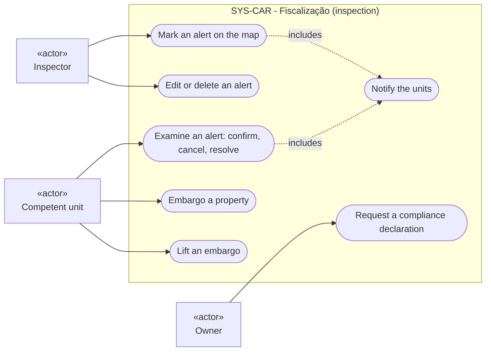
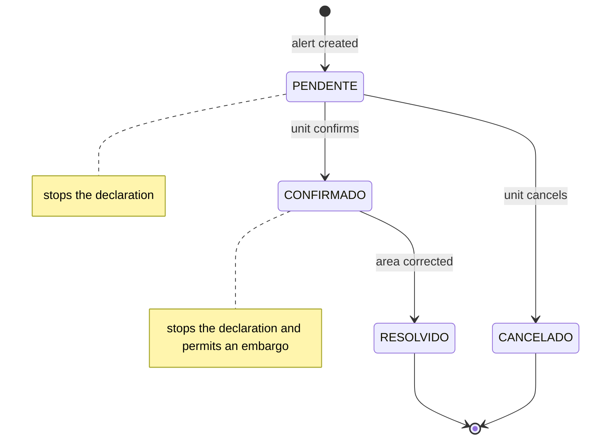
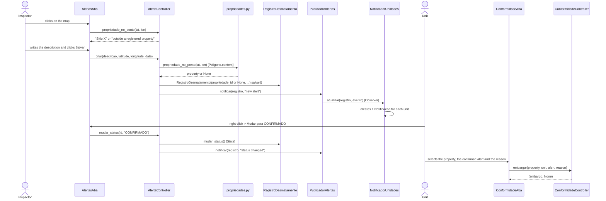
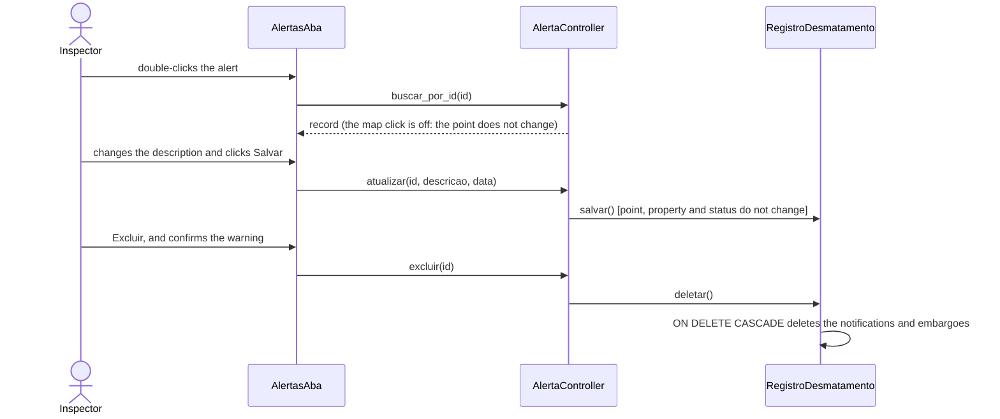
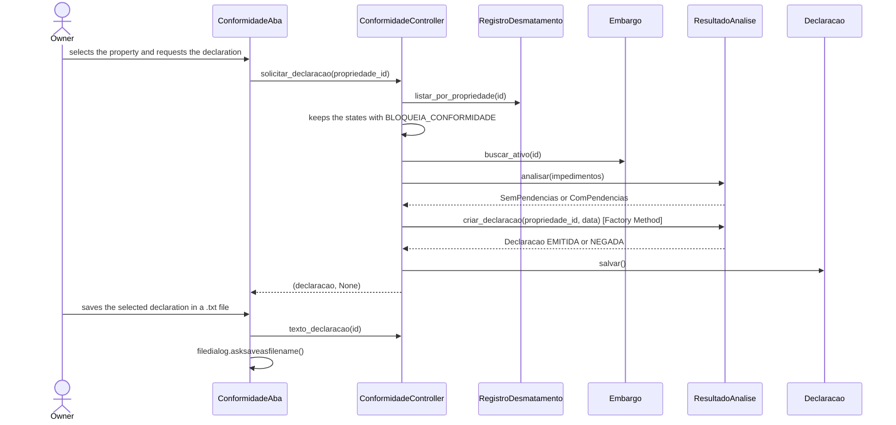
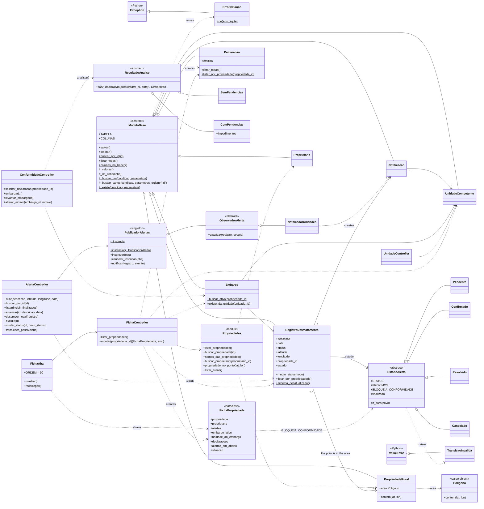
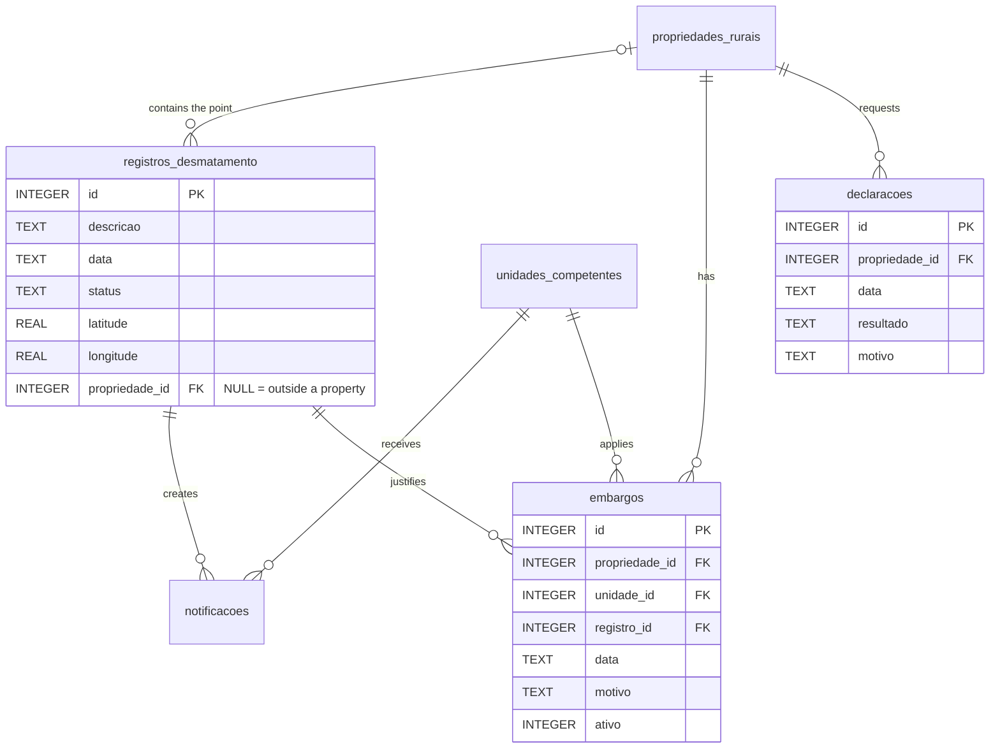

# Fiscalização UML diagrams

Portuguese version: [diagramas.pt-br.md](diagramas.pt-br.md). The names of the classes, methods and tables are in Portuguese, as in the code.

## Use cases

Mermaid does not have a use case diagram. This diagram uses a `flowchart`:
the rectangles are the actors and the round shapes are the use cases.

## Alert states (State)

This diagram shows the statuses of the alert and the permitted status changes.
The CRUD `atualizar()` does not change the status (see [ADR-F12](ADR-F12-crud-do-alerta.en.md)).

## Sequence: record → notify → examine → embargo

This diagram shows the path of an alert:

1. The inspector clicks on the map. The property is the property that contains the point ([ADR-F14](ADR-F14-ponto-do-alerta-define-a-propriedade.en.md)).
2. The system notifies the competent units.
3. The unit confirms the alert.
4. The unit embargoes the property.

## Sequence: edit and delete an alert (CRUD)

## Sequence: request a compliance declaration (Factory Method)

This diagram shows how the system decides to issue or refuse the compliance declaration.
The result of the analysis creates the declaration (see [ADR-F11](ADR-F11-remocao-das-fontes-e-factory-na-declaracao.en.md)).

## Implementation classes

This diagram shows the location of each design pattern:

- `ModeloBase` applies the Template Method. Only `ModeloBase` has the SQL for INSERT, UPDATE, DELETE and SELECT. Each model declares `TABELA` and `COLUNAS`. The 5 Fiscalização models inherit from it, as the Cadastro models do. Thus, the alert CRUD (`criar`, `atualizar`, `excluir`) is in `AlertaController`, which uses `salvar()` and `deletar()` of `ModeloBase`.
- `PropriedadeRural`, `Proprietario` and `Poligono` are Cadastro classes. They are in this diagram only to show the contract `propriedades.py`. This contract is the only access of the Fiscalização to the Cadastro. `propriedade_no_ponto()` uses `Poligono.contem()` to find the property of the alert (ADR-F14).
- `ResultadoAnalise` applies the Factory Method.
- `EstadoAlerta` applies the State pattern.
- `ObservadorAlerta` and `PublicadorAlertas` apply the Observer pattern.
- `TransicaoInvalida` and `ErroDeBanco` are the exceptions of the system (see [ADR-003](../decisoes/ADR-003-estrategia-de-excecoes.en.md)).
- `PublicadorAlertas` also applies the Singleton pattern. The system uses one instance, from `instancia()`. The constructor stays public. Thus, the tests can give isolated publishers.

## Data model

The deletion of a property deletes its embargoes and declarations (`ON DELETE CASCADE`). Its alerts stay without a property (`ON DELETE SET NULL`, ADR-F14).
The deletion of an alert deletes its notifications and embargoes.
A partial unique index permits a maximum of one active embargo for each property.

