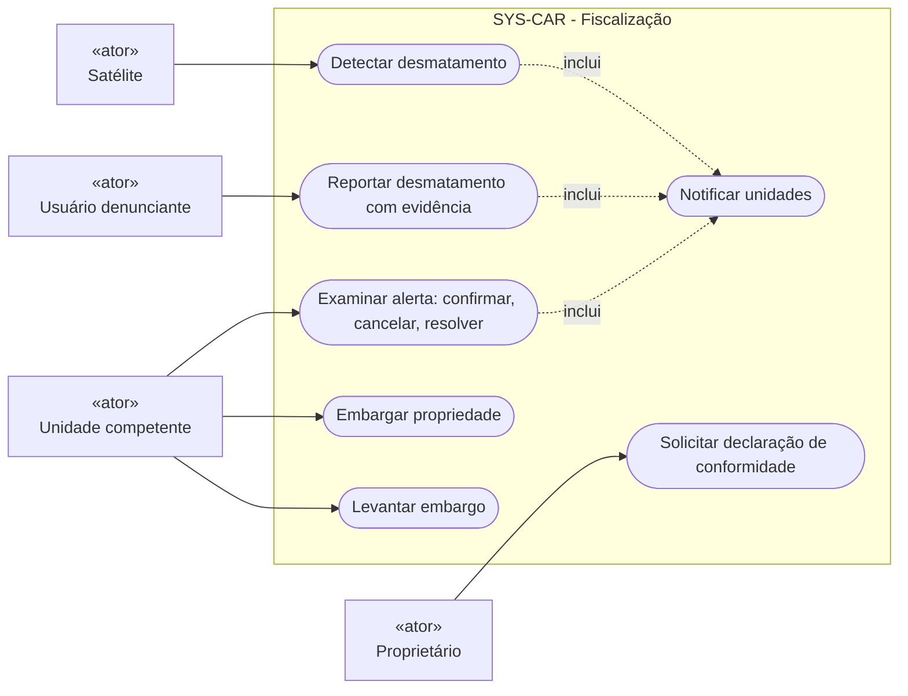
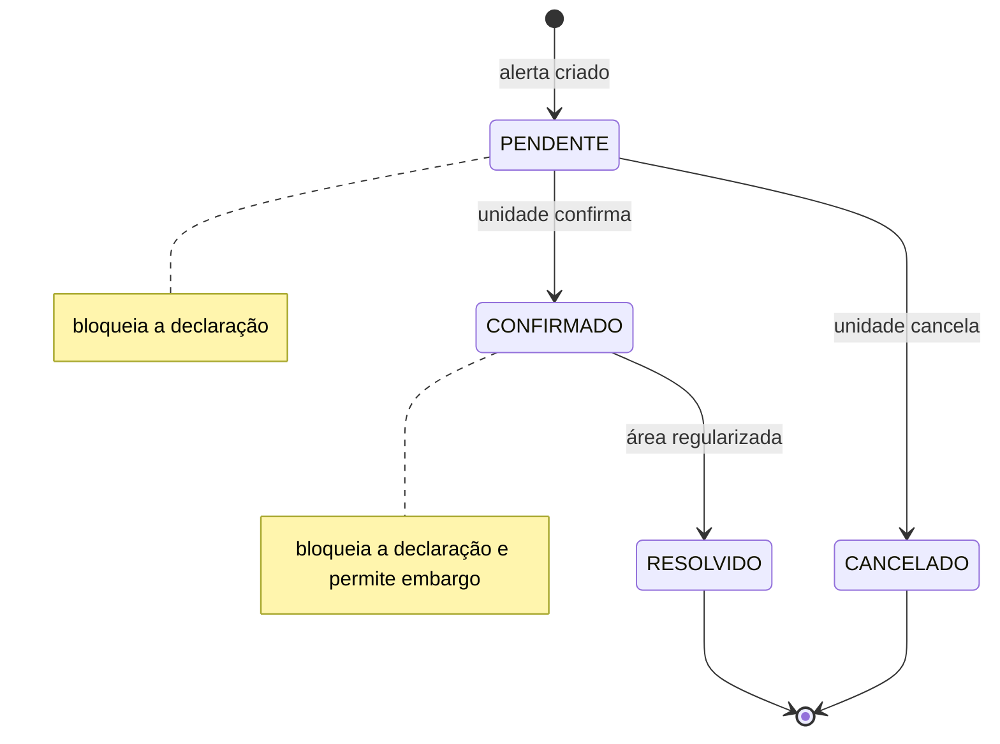
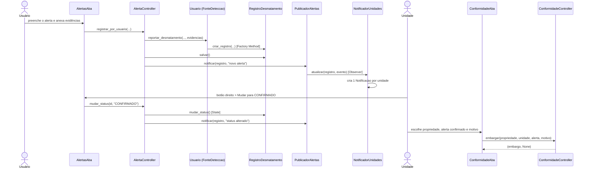
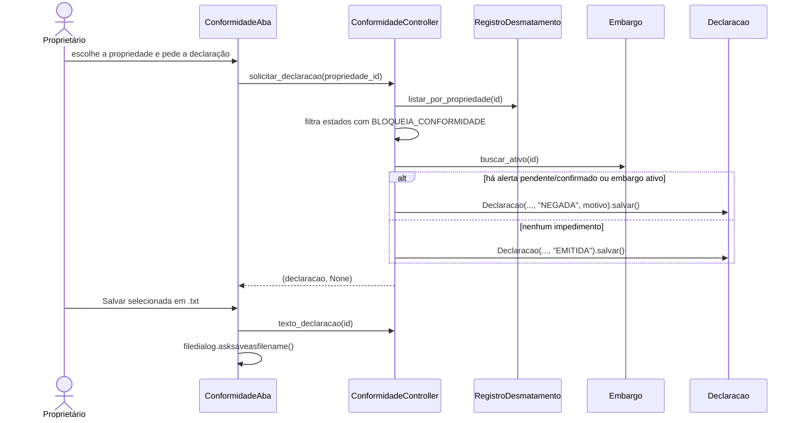
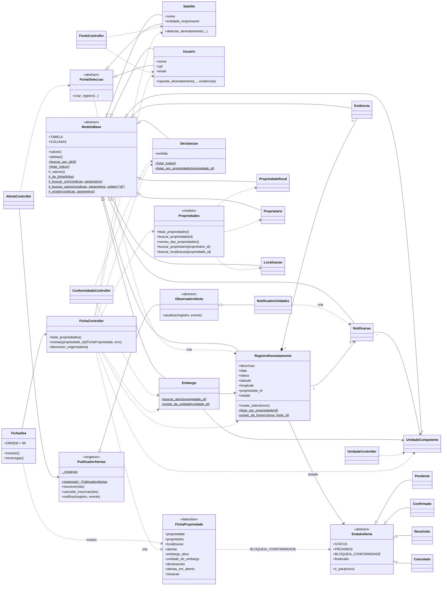
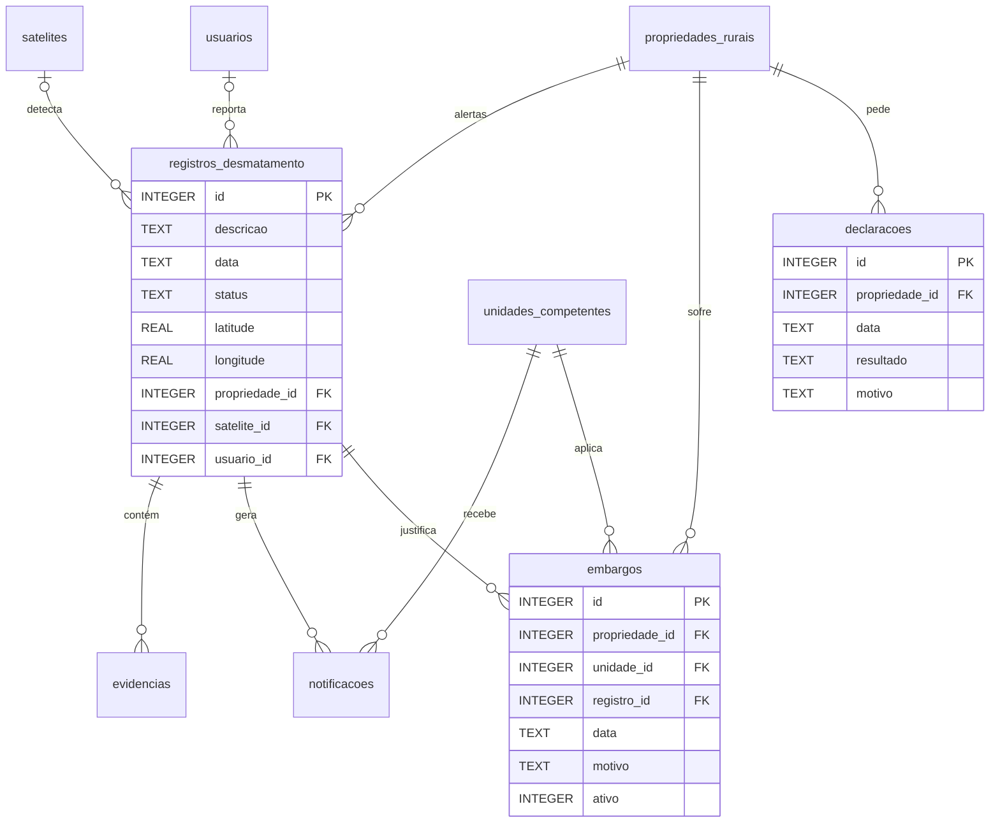

# Diagramas UML da Fiscalização

## Casos de uso

O Mermaid não tem diagrama de caso de uso nativo. Este diagrama usa um `flowchart`:
os retângulos são os atores e as formas arredondadas são os casos de uso.

## Estados do alerta (State)

Este diagrama mostra os status do alerta e as mudanças de status permitidas.

## Sequência: reportar → notificar → examinar → embargar

Este diagrama mostra o caminho de um alerta:

1. O usuário reporta o desmatamento.
2. O sistema notifica as unidades competentes.
3. A unidade confirma o alerta.
4. A unidade embarga a propriedade.

## Sequência: pedir declaração de conformidade

Este diagrama mostra como o sistema decide se emite ou nega a declaração de conformidade.

## Classes da implementação

Este diagrama mostra onde está cada padrão de projeto:

- `ModeloBase` aplica o Template Method: o SQL de INSERT, UPDATE, DELETE e SELECT fica só nele. Cada model declara `TABELA` e `COLUNAS`. Os 8 models da Fiscalização herdam dele, como os do Cadastro.
- `PropriedadeRural`, `Proprietario` e `Localizacao` são do Cadastro. Aparecem aqui só para mostrar o contrato `propriedades.py`, que é o único ponto de acesso da Fiscalização ao Cadastro.
- `FonteDeteccao` aplica o Factory Method.
- `EstadoAlerta` aplica o State.
- `ObservadorAlerta` e `PublicadorAlertas` aplicam o Observer.
- `PublicadorAlertas` também aplica o Singleton: o sistema usa uma única instância, obtida por `instancia()`. O construtor continua público para os testes injetarem publicadores isolados.

## Modelo de dados

Apagar uma propriedade apaga os alertas, as evidências, as notificações, os embargos e as declarações dela (`ON DELETE CASCADE`).
Um índice único parcial garante no máximo um embargo ativo por propriedade.

