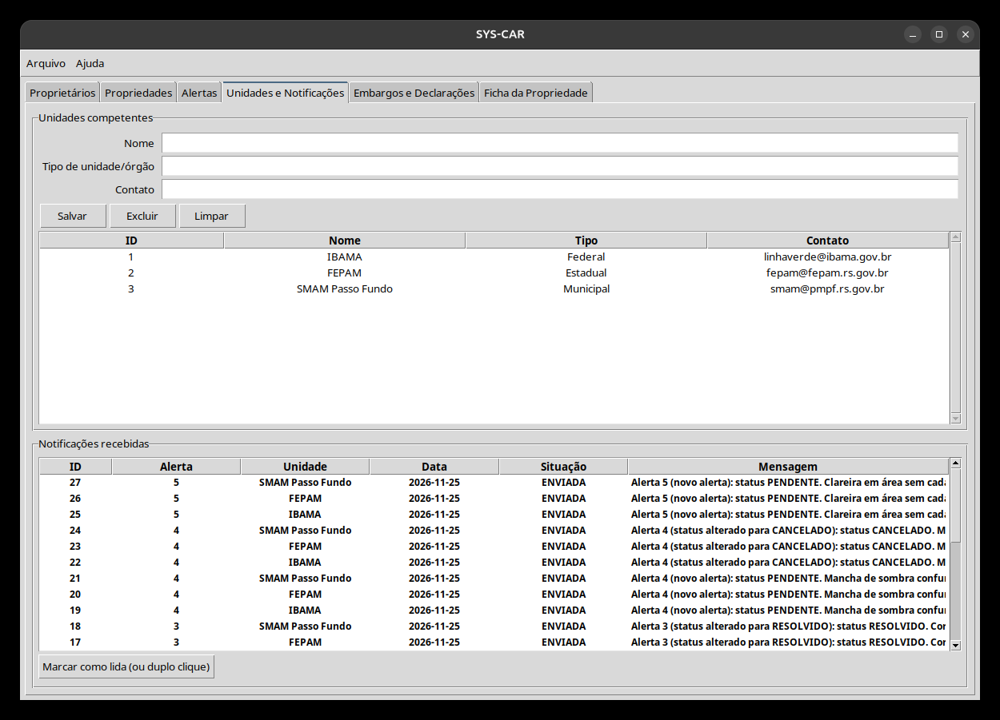
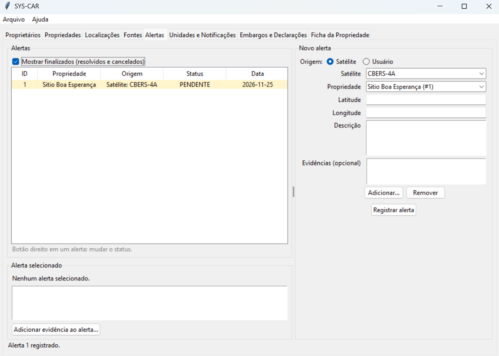
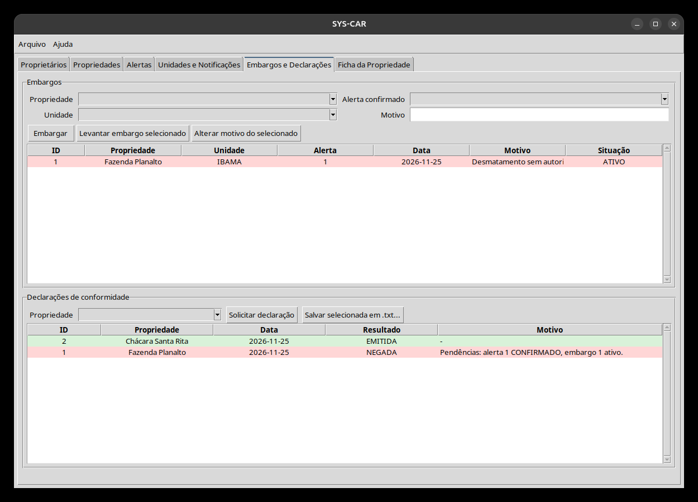
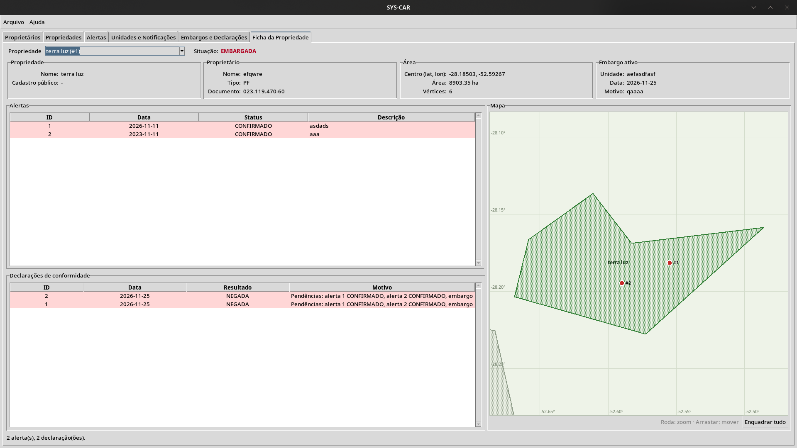

# Como usar a Fiscalização do SYS-CAR

Este guia usa frases curtas.
Cada passo tem uma ação.

## O que é a Fiscalização

A Fiscalização cuida do desmatamento.
Ela guarda:

- os **alertas**: avisos de que alguém cortou a mata;
- as **unidades**: os órgãos que fiscalizam, por exemplo o IBAMA;
- os **embargos**: proibições de usar a terra;
- as **declarações**: papéis que dizem se a terra está em ordem.

## Cadastrar um órgão

1. Clique na aba **Unidades e Notificações**.
2. Escreva o nome do órgão.
3. Clique em **Salvar**.

## Registrar um alerta

1. Clique na aba **Alertas**.
2. Clique no mapa, no lugar do desmatamento.
3. O formulário mostra a propriedade desse lugar.
4. Se o lugar não é de nenhuma propriedade, aparece "fora de propriedade cadastrada".
5. Escreva a data. Se ficar vazia, vale a data de hoje.
6. Escreva o que aconteceu.
7. Clique em **Salvar**.

O mapa mostra as propriedades e os alertas.
A cor do ponto mostra o estado do alerta:
amarelo é PENDENTE, vermelho é CONFIRMADO, verde é RESOLVIDO e cinza é CANCELADO.

Todo alerta novo fica **PENDENTE**.
Os órgãos recebem um aviso.

## Mudar os dados de um alerta

1. Na lista de alertas, clique duas vezes no alerta.
2. Os dados aparecem no formulário.
3. Mude a data ou o texto.
4. Clique em **Salvar**.

O lugar do alerta não muda.
A propriedade do alerta não muda.
Se o lugar está errado, apague o alerta e marque outro.
O estado do alerta não muda aqui.

## Apagar um alerta

1. Na lista de alertas, clique no alerta.
2. Clique em **Excluir**.
3. Leia o aviso e confirme.

Atenção: os avisos e os embargos deste alerta também são apagados.

## Mudar o estado de um alerta

1. Na lista de alertas, clique com o **botão direito** no alerta.
2. Escolha o novo estado.

Os estados são:

- **PENDENTE**: ainda não foi visto;
- **CONFIRMADO**: o desmatamento é verdade;
- **CANCELADO**: o alerta estava errado;
- **RESOLVIDO**: o problema foi corrigido.

## Embargar uma propriedade

1. Clique na aba **Embargos e Declarações**.
2. Escolha a propriedade.
3. Escolha o alerta confirmado.
4. Escolha o órgão.
5. Escreva o motivo.
6. Clique em **Embargar**.

Só é possível embargar com um alerta **CONFIRMADO**.

## Tirar o embargo

1. Clique no embargo na lista.
2. Clique em **Levantar embargo selecionado**.

O embargo continua na lista, com a situação **LEVANTADO**.
Um embargo nunca é apagado.

## Mudar o motivo do embargo

1. Clique no embargo na lista.
2. O motivo aparece no campo **Motivo**.
3. Escreva o motivo certo.
4. Clique em **Alterar motivo do selecionado**.

## Pedir a declaração

1. Escolha a propriedade.
2. Clique em **Solicitar declaração**.
3. A declaração é **EMITIDA** quando está tudo certo.
4. A declaração é **NEGADA** quando há alerta aberto ou embargo.
5. O motivo aparece na lista.

Uma declaração não muda e não é apagada.
Se a situação da terra mudar, peça uma declaração nova.

## Salvar a declaração

1. Clique na declaração na lista.
2. Clique em **Salvar selecionada em .txt...**.
3. Escolha a pasta.
4. Clique em **Salvar**.

## Ver tudo sobre uma terra

1. Clique na aba **Ficha da Propriedade**.
2. Escolha a propriedade.
3. A ficha mostra o dono, a área, os alertas, o embargo e as declarações.
4. O mapa mostra a área da terra e os alertas.

No alto da ficha aparece a **Situação**:

- **REGULAR**: está tudo certo;
- **COM ALERTAS EM ABERTO**: há um alerta que a unidade ainda precisa examinar ou resolver;
- **EMBARGADA**: a terra está embargada.
